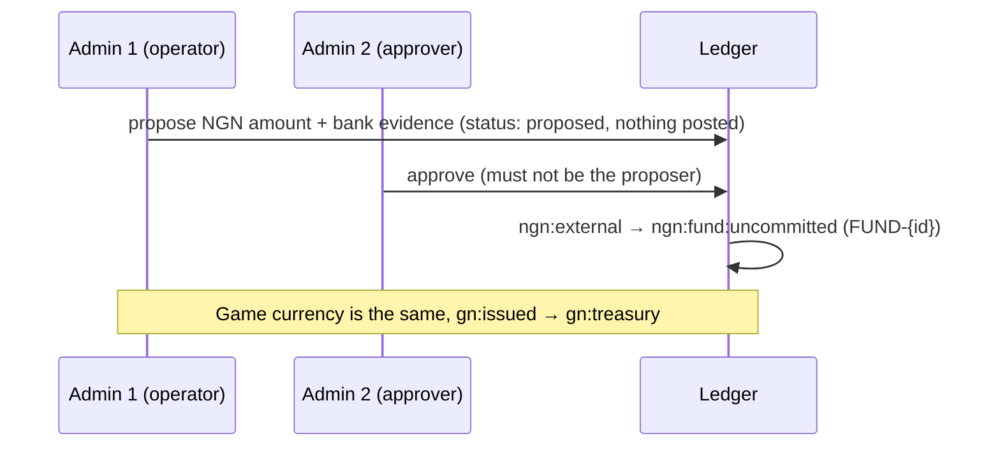
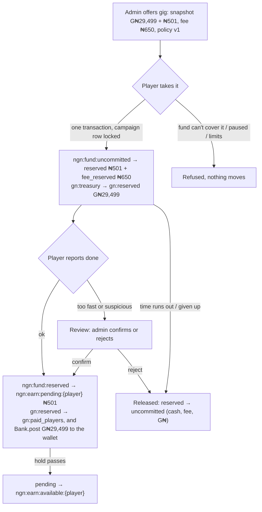
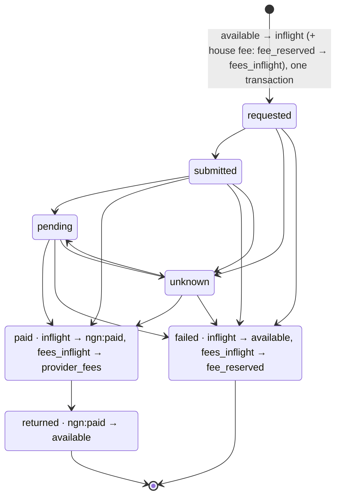

# Funded split paychecks: money flows and runbook

Companion to `01-assessment-and-plan.md`. Code: `lib/src/rewards/`. Tests: `test/unit/reward_math_test.dart`, `test/integration/funded_rewards_test.dart`.

## 1. The two treasuries

| | Virtual City Treasury | Real Rewards Fund |
|---|---|---|
| Holds | Game Naira (G₦), whole naira | Real naira (NGN), in kobo |
| Lives | in the game | outside the game (bank / payout provider); the ledger records it |
| Filled by | an approved **GN issuance** (two admins) | an approved **NGN funding** with bank evidence (two admins) |
| Pays | the game half of a funded paycheck, into the player's normal wallet (`Bank.post`) | the cash half, to the player's Real Earnings, then out by withdrawal |
| Withdrawable | never | yes, once available, verified, and payouts are live |
| Seen by | admins only (Treasury screen) | admins only (Treasury screen) |

Every journal moves exactly one unit and always balances to zero. Journals and entries are append-only (database triggers refuse updates and deletes). Every posting has an idempotency key.

## 2. Accounts

**NGN (kobo)**

| Account | Meaning |
|---|---|
| `ngn:external` | the outside world; goes negative by what was recorded as received |
| `ngn:fund:uncommitted` | in the fund, free to back new gigs |
| `ngn:fund:reserved` | cash promised to players who took a gig |
| `ngn:fund:fee_reserved` | payout-fee allowance set aside with each taken gig |
| `ngn:earn:pending:{player}` | earned, inside the verification hold, not withdrawable |
| `ngn:earn:available:{player}` | earned and withdrawable |
| `ngn:payout:inflight:{player}` | asked to withdraw, not yet settled by the provider |
| `ngn:payout:fees_inflight` | the house-paid fee for in-flight payouts |
| `ngn:paid` | confirmed paid out |
| `ngn:provider_fees` | fees the provider charged |

**GN (whole naira)**: `gn:issued` (source), `gn:treasury`, `gn:reserved`, `gn:paid_players`, `gn:levy` (unused; the levy is off).

**Invariants** (checked on the Treasury screen):
- NGN: `-ngn:external` = uncommitted + reserved + fee_reserved + pending + available + in flight + fees in flight + paid + provider fees.
- GN: `-gn:issued` = treasury + reserved + paid to players.
- No account except the two sources is ever negative.

## 3. Flows

### Funding (two people)

### A funded gig, from offer to paycheck

Example at policy v1 (167 bp, rounded down): basis 30,000 → **G₦29,499 + ₦501**. Fee allowance ₦650 (the spec's test-3 figure).

The fee allowance stays in `fee_reserved` after completion; it is what pays the house's payout fee later.

### Withdrawal

- A timeout is **unknown**, never failed. The money stays in flight and is never resubmitted under a new reference.
- Provider reports arrive at `POST /rewards/v1/provider/{name}`, signed with HMAC-SHA256 (`REWARDS_PROVIDER_SECRET`) in `x-wyrd-signature`. Each report is recorded once. Bad signature → 401, nothing moves. Duplicate or out-of-order → recorded and ignored. Server error → 500, nothing recorded, the provider retries.

## 4. Switches and settings

All default **off**. Set as server environment variables.

| Setting | Effect |
|---|---|
| `FUNDED_JOBS_ENABLED` | funded gigs show and can be taken |
| `REWARDS_SANDBOX` | test mode: withdrawals go to the mock provider; screens say SANDBOX |
| `LIVE_PAYOUTS_ENABLED` | real payouts, **and only if** every key below is set |
| `LIVE_COLLECTIONS_ENABLED` | real money in (not built) |
| `CITY_LEVY_ENABLED` | the optional 0.5% levy (not used) |

Live payouts also need: `PAYOUT_PROVIDER`, `PAYOUT_KYC_PROVIDER`, `PAYOUT_MIN_AGE`, `PAYOUT_JURISDICTIONS`, `PAYOUT_MIN_WITHDRAWAL_KOBO`, `PAYOUT_MAX_WITHDRAWAL_KOBO`, `PAYOUT_DAILY_LIMIT_KOBO`, `PAYOUT_FEE_KOBO`, `PAYOUT_FEE_PAYER`, `PAYOUT_REVIEW_HOURS`, `PAYOUT_TERMS_URL`, `PAYOUT_APPROVAL_REF`. Plus `REWARDS_PROVIDER_SECRET`. Secrets stay on the server.

In-app pause switches (Treasury screen, operators): **New funded places** and **New payouts**. Pausing never takes away what players already took or earned.

## 5. Roles

| Role | Can |
|---|---|
| Owner (the drone operator) | everything, and grants roles |
| viewer | see the Treasury screen, export |
| operator | propose funding, offers, policies, switches, reviews |
| approver | approve or reject someone else's funding proposal |

Every admin action is written to `reward_audit`. WYRD (the AI) can explain figures; it has no tool that moves money.

## 6. Runbook

### Turn on the sandbox
1. Set `REWARDS_SANDBOX=true` and `FUNDED_JOBS_ENABLED=true`, plus `REWARDS_PROVIDER_SECRET` (any long random string). Redeploy.
2. Give a second admin a role (the owner, via `rewardsAdmin.setRole`) so funding can be approved by two people.
3. Treasury → Money in: propose test NGN (e.g. ₦100,000, evidence "sandbox") and test G₦; the other admin approves.
4. Treasury → Funded gigs: offer one. Check the preview line.
5. As a player: Wallet → Real Earnings → take it, finish it, withdraw. The mock provider settles it.

### Add real money (later, only once live is approved)
1. The money is in the bank first. Record the exact statement line as evidence.
2. Propose; a second admin checks the bank and approves.
3. Match `fundedTotal` on the Treasury screen against the bank statement after each funding.

### Housekeeping (automatic)
Every 5 minutes `RewardsFutureCall` (identifier `rewards-tick`) moves cash past its hold to available, gives back the reservation of gigs past their deadline, and pays any missing game pay. Each step is idempotent. Failures are logged as `[rewards] … failed` and retried on the next tick.

### Daily checks
- Both ✅ balanced on the Treasury screen.
- "Completed gigs with game pay missing" is 0. If not, see below.
- Flagged completions: clear them.
- In-flight payouts older than a day: see "stuck payout".

### Something looks wrong: pause first
Treasury → Switches → pause **New funded places** and **New payouts**. Nothing already earned is lost. Export the CSV before changing anything.

### A stuck payout (unknown or pending for long)
1. Do **not** retry it under a new reference, and do not move money by hand.
2. Ask the provider for the status of that reference.
3. The provider's signed report settles it. If the provider can't send one, record the outcome as a signed event from the provider's dashboard export (same route, same secret). Never edit the ledger.

### A balance check fails
1. Pause both switches. Export the CSV.
2. Compare `fundedTotal` with the bank; compare journals per reference.
3. Fix only with new, balancing journals (never edits), with a second admin's approval. Note the reason in the audit.

### Game pay missing on a completed gig
`FundedJobs.repairGameRewards` re-posts the game half with the same idempotency key (`funded:{id}:game`), so running it twice pays once. It runs every 5 minutes (`RewardsFutureCall`), and operators can run it now from the Treasury screen (**Pay the missing game pay now**, shown when the count is above 0).

### Change the cash share, fee allowance or hold
Treasury → Reward policy → save a new version. Existing offers keep theirs. Only offers created afterwards use it.

## 7. Open items before anything goes live

- A real payout provider adapter, KYC and beneficiary verification.
- The published verification hold (policy v1 has 0 hours), limits, fees and terms.
- Everything under "launch blockers" in `01-assessment-and-plan.md`: legal classification, terms, age and jurisdiction rules, disputes, reconciliation against real bank statements.
